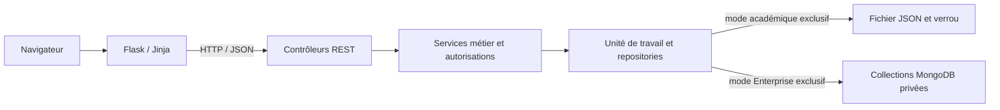

# ADR 0001 — JSON académique et MongoDB Enterprise

Date : 10 novembre 2026. Statut : **décision adoptée et modèle documentaire éprouvé ; backend applicatif, migration et déploiement MongoDB non réalisés**.

## Contexte et état réellement préservé

Le nouveau mandat utilisateur remplace la direction de persistance de la première mission 2.0 : MongoDB devient la source de vérité du mode Enterprise, avec maintien d’un mode académique réellement fondé sur un fichier JSON. Les échanges web–API restent HTTP/JSON. BSON est le format documentaire de MongoDB, distinct du fichier JSON pédagogique.

La référence livrée reste `v1.0.0` : API `6a86f2e`, web `f3d10cb`, infrastructure `9255fba` (tag infra `12af518`). Les bundles de sauvegarde et le PDF original sont conservés. Deux correctifs ultérieurs sont commités dans des worktrees isolés : API `c0a6d61625da8bfa0967be0bdc6cf950ae66420d` pour la réauthentification et web `53735465a081d4382c3a44874a441080024b32d1` pour les listes et erreurs de formulaires. Leurs branches de qualité ont été poussées et leurs CI ont réussi ; aucune release ni bascule des services stables n’en découle.

Le relevé initial comptait 185 tests API et 361 tests web. La fondation documentaire a ensuite porté l’API à 214 tests locaux réussis et ajouté des essais réels du moteur et du driver, décrits dans l’[étude exécutée](../quality/MONGODB_ENGINE_STUDY.md). Les CI des correctifs web/auth et le gate interservices JSON ont réussi sous Windows et Linux. La couverture du **backend métier MongoDB reste nulle** tant que ses repositories/services ne sont pas intégrés. Les services Swarm stables ont été revérifiés par SSH : une réplique web et une API, images v1 inchangées. Aucun magasin existant n’est migré ou modifié par cet ADR.

## Contraintes tirées du code

`app/storage_v2.py` porte un document unique à dix tableaux : users, sessions, auth_attempts, idempotency_records, movies, copies, collections, loans, reservations et audit_events. `V2Store.transact()` tient un verrou pendant lecture, callback, validation, incrément de révision et remplacement atomique. Les callbacks actuels manipulent ce document et peuvent construire une réponse Flask : ce couplage doit être retiré progressivement de la frontière de persistance.

L’autorisation, les états et les versions doivent rester cohérents dans une même unité de travail. Une session ou un rôle lus avant la transaction ne peuvent autoriser une mutation après une révocation concurrente. Une copie ne peut avoir deux prêts actifs ; les réservations gardent leur ordre et leurs liens aux prêts. La dernière identité administrateur active reste protégée. Les collections restent privées, y compris face aux gestionnaires.

`RegistrationAdmission` et `MetadataCache` possèdent actuellement des fichiers et verrous distincts. Ils font partie de l’étude : laisser des compteurs d’admission locaux à chaque instance Enterprise créerait une protection différente selon le processus. Les reçus d’idempotence, les historiques et la quarantaine de reprise ne doivent pas être oubliés lors de la migration.

Les limites globales de tableaux proviennent du stockage fichier et de sa validation. Les réutiliser mécaniquement comme architecture MongoDB, ou placer tout le document dans un seul BSON, conserverait ses défauts et introduirait une limite de taille supplémentaire. Les règles métier et les budgets anti-abus seront distingués des limites physiques propres au moteur.

## Décision

Un seul moteur est sélectionné à l’initialisation par `STORAGE_BACKEND=json|mongodb`. Les profils académiques sélectionneront explicitement JSON ; le profil Enterprise 2.0 sélectionnera MongoDB. Une valeur inconnue ou une configuration MongoDB incomplète doit faire échouer le démarrage. Une panne MongoDB ne déclenche jamais de repli silencieux vers un fichier JSON. Aucune double écriture permanente n’est introduite.

La présentation conserve son client HTTP. Les contrôleurs API ne contiennent pas de requêtes PyMongo. Une petite unité de travail et des repositories explicites porteront les accès nécessaires aux services métier, avec deux implémentations. Les mêmes règles d’autorisation et de transition seront exécutées sur les deux moteurs. Nous introduirons cette frontière par opérations cohérentes, en gardant les tests JSON ; un adaptateur transitoire de callbacks peut servir à la migration du code, mais il ne constituera pas la cible finale d’accès MongoDB.

Il s’agit de deux chemins de configuration exclusifs, et non de deux destinations pour une mutation. Les opérations métier simples utiliseront une écriture conditionnelle quand elle suffit. Les transitions concernant plusieurs entités utiliseront une transaction réelle lorsque cette atomicité est nécessaire.

## Modèle documentaire initial à éprouver

| Collection | Choix initial | Contraintes et requêtes à vérifier |
| --- | --- | --- |
| users | Un document par compte ; rôle enum embarqué | UUID stable, username canonique unique, état actif ; protection du dernier admin dans l’unité de travail |
| sessions | Une session par document ; empreinte du bearer seulement | Empreinte unique, user_id indexé, expirations et révocations explicites |
| auth_attempts / admission | Compteurs partagés et bornés | Clés HMAC uniques, budgets atomiques avant Argon2, recul d’horloge et saturation conservateurs |
| movies | Un document par film ; acteurs et genres embarqués | UUID stable, tableaux ordonnés, recherche et filtres mesurés ; aucune collection people/genres sans besoin démontré |
| copies | Un document par exemplaire référant le film | Unicité de l’identité, requêtes par film et état ; intégrité historique |
| collection_entries | Une entrée par propriétaire, film, type et nom canonique | Index d’unicité correspondant aux règles actuelles, requêtes toujours bornées par owner_id |
| loans | Un document par prêt et transitions contrôlées | Index partiel unique pour un exemplaire en prêt actif ; vérification transactionnelle du compte, de la copie, des quotas et de la file |
| reservations | Une réservation par document | Unicité d’une attente propriétaire/film, ordre serveur stable et transaction d’attribution |
| idempotency_records | Reçu lié à acteur, clé et opération | Contenu/digest, résultat et expiration ; répétition sans recréation métier |
| audit_events | Événement métier dans la transaction correspondante | Pagination et rétention explicites ; journal de sécurité distinct sans corps ni secrets |
| metadata_cache | Cache et quotas partagés | Origine externe fixe, bornes et dates fraîches/de secours ; absence de vérité métier secondaire |
| coordination | Petits documents de coordination ciblés | Ordre des réservations et contraintes transversales qui ne peuvent être imposées par un index seul |

Favorites et watchlists restent des types d’entrée ; roles reste un enum. Reviews et nouvelles entités ne sont pas créés uniquement parce que le moteur les permet. Le modèle détaillé, les `$jsonSchema` et les index effectifs seront versionnés avant migration.

Les UUID publics restent des chaînes canoniques, sans conversion implicite en ObjectId. Le premier modèle implémenté conserve les entiers, années et horodatages en BSON Int64 ; les horodatages restent des secondes UTC entières depuis l’époque Unix, sans passage par une date locale ou une conversion en millisecondes. Le décodage produit explicitement un `int` Python, distinct de bool, avant validation métier. Ce choix conserve notamment les secondes jusqu’à 2^53 déjà admises dans les métadonnées. Un entier hors plage Int64 est refusé avant écriture et doit être signalé par la simulation de migration ; JSON conserve son contrat propre. Les dates nulles gardent leur sens. Aucun TTL asynchrone ne remplace une décision d’expiration de sécurité dans l’API.

## Transactions, conflits et erreurs

MongoDB standalone ne satisfait pas les exigences multidocuments. Un replica set à un membre est la première cible d’essai, avec authentification ; il n’apporte aucune redondance physique. Le serveur devra réellement établir son état primaire, accepter une transaction et annuler une transaction avant que l’API déclare ce backend prêt. Les paramètres de lecture/écriture et la version effective seront enregistrés avec ces essais. Voir [les considérations de transactions](https://www.mongodb.com/docs/v8.0/core/transactions-production-consideration/) et [l’initialisation d’un replica set](https://www.mongodb.com/docs/manual/tutorial/convert-standalone-to-replica-set/).

Le callback de `with_transaction()` peut être réexécuté. Nous sortirons de ce callback les appels réseau externes, la publication d’événements externes et tout effet non idempotent. Un résultat HTTP ne sera remis au client qu’après issue déterminée. Un commit d’issue inconnue ne justifie pas une répétition aveugle par le frontend ; les reçus d’idempotence et la consultation d’état restent nécessaires. Le [contrat PyMongo](https://www.mongodb.com/docs/languages/python/pymongo-driver/current/crud/transactions/) décrit ces possibilités de rejeu.

Les conflits d’unicité métier et de version seront traduits dans les erreurs REST existantes, sans transmettre d’exception MongoDB, d’URI ou d’identifiant secret. Une indisponibilité doit produire un refus contrôlé et un readiness négatif, sans faux succès ni écriture partielle.

Une transaction snapshot n’empêche pas, à elle seule, deux décisions concurrentes fondées sur un comptage puis écrivant des documents différents. La protection du dernier administrateur, les plafonds par bénéficiaire et l’ordre de file devront donc posséder une coordination écrite commune à la contrainte, ou une opération atomique équivalente. Les tests feront concourir ces chemins distincts ; le simple succès de deux transactions indépendantes ne prouverait pas l’invariant.

Le premier chemin d’implémentation retient un petit document scalaire de coordination, incrémenté en première écriture de chaque commande transactionnelle avant lecture des entités. Il conserve la sérialisation et la révision métier actuelles sans contenir les tableaux de données. Les lectures publiques restent ciblées. Ce compromis de contention est volontaire pour le laboratoire ; une séparation en gardes par agrégat devra être motivée et éprouvée ultérieurement. Un registre UUID intertypes préserve aussi l’unicité globale que vérifie le fichier JSON, notamment face aux imports. Voir le [plan d’implémentation MongoDB](../quality/MONGODB_IMPLEMENTATION_PLAN.md).

## Faisabilité Docker et sécurité

Relevé SSH du 10 novembre : VM2 dispose de 2 vCPU, 2 062 172 160 octets de RAM, environ 1,52 Go disponibles au relevé et 11,51 Go de disque libre. L’API utilise alors 61,02 Mio sous une limite de 512 Mio ; Docker rapporte 29.9.3/x86_64, et AVX est disponible. Ces chiffres décrivent un instant, pas un test de charge ni une garantie de cohabitation.

La série majeure 8.0 est retenue comme candidat d’étude à cycle maîtrisé ; les [notes officielles](https://www.mongodb.com/docs/v8.0/release-notes/8.0/) listent 8.0.34 comme correctif publié. La provenance, la compatibilité noyau et les contraintes de confinement sont contrôlées pour l’essai isolé ; l’analyse de vulnérabilités de l’image reste un gate avant intégration ou déploiement. Aucun tag flottant ne sera une référence de livraison.

Le manifeste `linux/amd64` de `mongo:8.0.34` a ensuite été résolu puis téléchargé par le digest `sha256:1d7a2d487c6465ea022474b90b65d6c91bb600b421b65880d8c6e141d6122200`. L’image occupe 1 272 354 992 octets selon Docker ; ce téléchargement n’est pas une preuve de fonctionnement du serveur ou un scan de vulnérabilités. Le noyau VM2 relevé est `6.8.0-139-generic`.

Un [essai moteur isolé](../quality/MONGODB_ENGINE_STUDY.md) a ensuite réellement validé primaire à un membre, authentification, privilèges séparés, validation documentaire, commit/abort de transactions à deux documents et persistance après redémarrage. Il utilise mongosh, un réseau conteneur `none` et deux volumes neufs ensuite supprimés. Ce résultat établit la faisabilité élémentaire du moteur retenu ; il ne valide pas encore PyMongo, le repository CineVault, ses invariants, la migration ou le déploiement Swarm MongoDB.

Le SDK d’étude local est PyMongo 4.19.0 avec dnspython 2.9.2 : roues Windows CPython 3.13 téléchargées depuis PyPI, SHA-256 vérifiés avant installation isolée et `pip check` réussi. Ils ne sont pas encore des dépendances de l’application livrée. La [compatibilité documentée](https://www.mongodb.com/docs/drivers/compatibility/?driver-language=python&python-driver-framework=pymongo) et les tests effectifs sur le serveur retenu devront être rapprochés avant intégration. Les licences constatées sont Apache-2.0 pour PyMongo et ISC pour dnspython ; MongoDB Community Server possède une [licence SSPL distincte](https://www.mongodb.com/legal/licensing/server-side-public-license/faq). La licence MIT du code CineVault ne décrit pas à elle seule ces composants.

Un conteneur MongoDB candidat aura un volume distinct, un réseau interne et aucun port public. Il ne montera ni le volume JSON stable ni le socket Docker. L’utilisateur de maintenance et l’utilisateur applicatif auront des rôles séparés ; l’API courante ne pourra pas modifier utilisateurs, index ou validateurs. Les secrets et le keyfile du replica set resteront hors Git, injectés selon les permissions effectives du conteneur.

La mémoire de WiredTiger doit être bornée avec celle du conteneur ; sa cache n’est pas toute sa consommation. Les [paramètres documentés](https://www.mongodb.com/docs/manual/core/wiredtiger/) sont une base d’essai, pas une mesure CineVault. Les limites, le RSS, le disque, l’oplog et les marges de l’API seront contrôlés sous charge synthétique avant de retenir la cohabitation VM2. Le manager demeure manager ; aucune transformation implicite des trois VM en base répliquée n’est prévue.

## Migration et retour arrière

La migration sera un outil séparé : simulation, validation de la source, empreinte, mapping explicite puis chargement dans une base candidate isolée. Relancer un même lot ne crée pas de doublons ; un identifiant existant avec un contenu différent constitue un conflit, pas une autorisation de l’écraser. Les validations et index restent actifs.

La comparaison portera sur comptes et hachages, rôles, films, copies, entrées privées, prêts, réservations, références, ordre et horodatages. Les mots de passe ne seront ni lus en clair depuis un export ni consignés. Les clés servant aux HMAC et l’état des sessions/compteurs exigent une politique de continuité explicite : une rotation non coordonnée ne doit pas effacer un budget d’essais.

Le basculement prévoit une sauvegarde finale vérifiée et un gel des écritures sur l’ancienne source. Après validation, seul MongoDB est ouvert en écriture. Avant toute nouvelle écriture, revenir au JSON sauvegardé est un rollback de configuration contrôlé. Après de nouvelles écritures MongoDB, une simple variable d’environnement ferait perdre ces changements : il faudra un export inverse validé, ou revenir au point sauvegardé avec perte explicitement déclarée. Les deux scénarios seront testés sur des données synthétiques avant utilisation réelle.

Les sauvegardes MongoDB utiliseront une méthode cohérente, une copie hors VM protégée, des empreintes et une restauration isolée. Copier à chaud les fichiers de son volume ne sera pas présenté comme une sauvegarde cohérente.

## Impacts et critères de passage

| Domaine | Travail nécessaire | Preuve de passage |
| --- | --- | --- |
| Architecture | Extraire accès et opérations métier sans dupliquer les règles | Même contrat testé sur JSON et MongoDB, aucun PyMongo dans contrôleurs HTTP |
| Modèle | Mapping BSON, validations, index et erreurs | Documents invalides rejetés par la base ; index vérifiés et explain représentatifs |
| Concurrence | Auth, dernière identité admin, attribution/FIFO et idempotence | Deux requêtes/processus sur une copie : un seul succès ; abort et panne sans incohérence |
| Compatibilité | Conserver les exercices et profils JSON, leurs volumes et scripts | Suite académique et démonstration fichier/API/Jinja toujours exécutables |
| Infrastructure | Replica set privé, volume, placement, secrets et ressources | Primaire/transactions/persistance/redémarrage/refus anonyme démontrés ; aucun accès public 27017 |
| Migration | Simulation, chargement idempotent et basculement exclusif | Comparaison exhaustive, connexion après migration et rollback avant/après écritures vérifiés |
| Sécurité | NoSQL, privilèges, URI, transport et budgets partagés | Régressions d’injection/autorisation, séparation maintenance/app, matrice ASVS mise à jour |
| Livraison | Paire exacte web/API et MongoDB réel en CI | Tests Windows/Linux appropriés, images et digest vérifiés, reçus de sauvegarde/restauration |
| Documentation | Matrices, architecture, dictionnaire, guides, site et rapport versionné | Sources cohérentes avec le code et preuves datées ; PDF original inchangé |

Ce changement ne suspend pas les travaux indépendants de frontend, de qualité et de documentation. En revanche, une stratégie définitive d’archivage Enterprise fondée sur le seul plafond du fichier JSON n’est plus la cible. Les constats de capacité v1 restent une référence historique et les protections anti-abus devront être reconduites dans le backend choisi.
