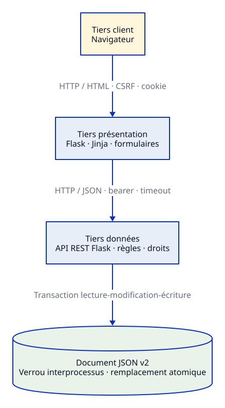
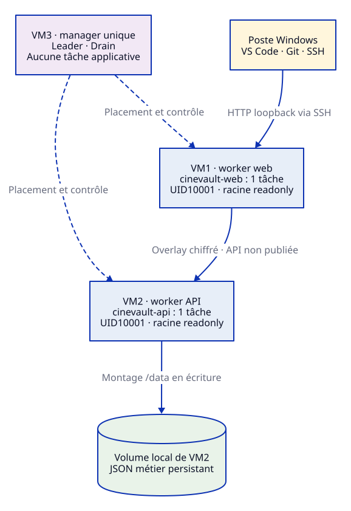

# Architecture effective et choix de modélisation

État vérifié le9novembre2026 à16h04Paris : API6a86f2e, webf3d10cb, trois VM Ubuntu24.04.5, cluster Docker29.9.3. Les modèles ci-dessous décrivent les responsabilités observées, sans exposer les adresses physiques du laboratoire. La [synthèse des validations](validation-current.md) donne les révisions complètes, les liens CI et les digests ; les [preuves pédagogiques](pedagogical-validation.md) distinguent Compose et Swarm.

## Trois tiers logiques

Le navigateur envoie des requêtes et formulaires au service web. Flask/Jinja produit le HTML ; le client HTTP natif applique des délais, refuse les redirections API, conserve les erreurs HTTP utiles et vérifie les structures JSON réellement consommées. Le frontend ne monte ni ne modifie le magasin métier. L'API authentifie, autorise et valide les requêtes ; elle seule détient le document JSON. Le manager orchestre ces services et ne constitue pas un quatrième tiers applicatif.

## Placement physique observé

| Machine logique | Rôle effectif | Ressources constatées | Exécution |
|---|---|---|---|
| VM1 | Worker de présentation | 2CPU, environ1966Mio RAM | Une tâche web ; publication8080 en mode host |
| VM2 | Worker propriétaire des données | 2CPU, environ1966Mio RAM | Une tâche API ; volume local persistant /data |
| VM3 | Manager dédié | 2CPU, environ1966Mio RAM | Leader, disponibilité Drain, aucune tâche applicative |

Les labels de placement maintiennent l'API sur le nœud qui détient son volume. Ajouter une seconde réplique API sur un autre hôte dupliquerait les fichiers au lieu de partager une transaction : cette configuration n'est pas proposée. Le manager unique, le worker API et son disque restent des points de défaillance. Une contrainte de placement ne déplace pas les données.

L'accès depuis le PC utilise VPN puis SSH strict par clé ; le tunnel HTTP est lié à127.0.0.1 sur le PC. Cela chiffre le trajet distant sans créer de terminaison HTTPS publique. Le port web reste publié sur les interfaces du worker ; seules des données synthétiques sont utilisées. L'API n'a aucun port publié et reçoit les appels par le nom de service sur un Overlay chiffré. Les contrôles préalables comprennent routage, DNS, ports Swarm et essais effectifs de l'Overlay ; une sonde UDP seule ne suffirait pas à prouver son fonctionnement.

## Exécution et intégrité

Les deux conteneurs exécutent Gunicorn avec deux workers, en UID10001, racine en lecture seule, capacités retirées et /tmp explicitement en tmpfs. Le document métier est partagé entre les processus de l'unique conteneur API ; un verrou fichier interprocessus protège toute la transaction lecture-modification-écriture. Le candidat complet est validé, écrit dans un fichier temporaire du même dossier, synchronisé puis remplacé atomiquement. Le verrou local à un thread serait insuffisant entre workers Gunicorn.

Le document v2 contient utilisateurs, sessions, compteurs d'authentification, reçus idempotents, films, exemplaires, collections, prêts, réservations et audit. Le modèle historique `{films:[…]}` reste utilisable pour les exercices pédagogiques. Les deux modes et leurs fichiers sont explicitement distincts ; une installation Enterprise exige une initialisation et un premier administrateur locaux, jamais un compte par défaut dans le dépôt.

Les comptes utilisent des rôles member/manager/admin relus côté API. L'exploitant système est un acteur séparé. Les jetons de session sont opaques et leurs empreintes seules sont stockées. Les requêtes anonymes de connexion/inscription portent un contexte de visiteur signé par une clé dédiée ; un en-tête IP libre n'est pas une identité de confiance. Une admission bornée, séparée du verrou métier, précède le calcul Argon2 à l'inscription. Les limites et leurs réserves sont documentées dans les sources et les tests.

Les métadonnées transitent par un cache distinct, sous verrou distinct et avec budgets de requêtes. Une URL d'affiche autorisée est ensuite chargée directement par le navigateur depuis Commons ; le frontend n'est pas un proxy arbitraire. Un fournisseur indisponible ne bloque pas la consultation du catalogue. La création enrichie revalide droits et données après le réseau externe ; elle ne tient pas le verrou métier pendant l'attente réseau.

## Développement monté et déploiement immuable

Le socle `compose.yaml` monte le code hôte en lecture seule et fournit un volume de données distinct. Son fonctionnement a été vérifié avant Swarm puis rafraîchi dans une pile isolée : voir [la campagne pédagogique](pedagogical-validation.md). Les images Swarm embarquent au contraire le code à une révision contrôlée. Les deux pratiques répondent à des besoins différents et coexistent.

Les CI Windows/Ubuntu testent chaque application, vérifient la qualité et les dépendances, construisent l'image, la démarrent sans privilège et la scannent. Le job autorisé publie seulement l'image contrôlée. La stack utilise un digest GHCR vérifié par la chaîne manifeste/configuration et par les conteneurs réellement lancés. La première méthode de préchargement SFTP est conservée comme historique, pas présentée comme le mode courant.

## Limites et documents associés

Le stockage local persiste lors d'une recréation de conteneur, mais n'est ni répliqué ni une sauvegarde. Une reprise d'exploitation doit restaurer sur une cible isolée, neutraliser les anciens accès et vérifier les données avant bascule. Les essais de reprise locaux sont distincts des mises à jour récentes qui préservent les comptes existants. Aucun RTO/RPO garanti n'est revendiqué.

Le boot autonome depuis le disque de VM2/3, la restauration après perte de disque, la haute disponibilité et HTTPS public ne sont pas démontrés. Les [données et messages](data-dictionary.md), les [acteurs et cas d'utilisation](actors-use-cases.md), les [modèles d'exécution](execution-model.md) et les [séquences vectorielles](diagrams/README.md) détaillent le code ; le rapport et l'audit de conformité restent des livrables séparés.
