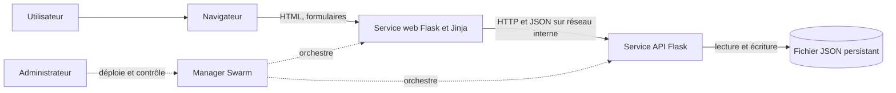
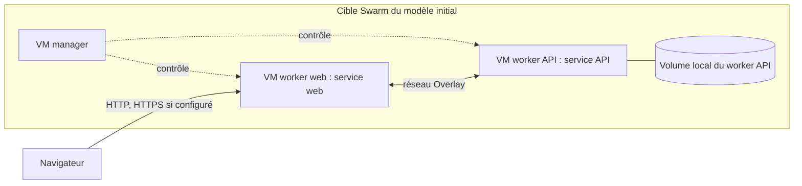
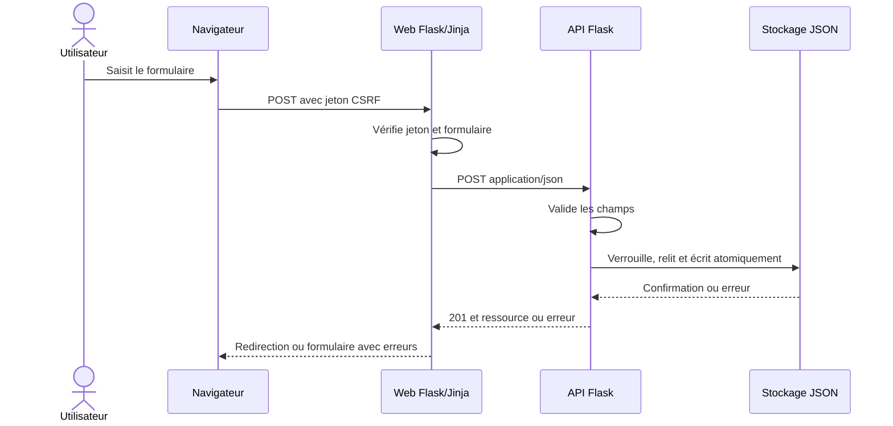

# Architecture et modélisation

**Lecture historique et état courant.** Les paragraphes de conception ci-dessous précèdent les validations distribuées des 8 et 9 novembre 2026 ; leurs mentions « cible » ou « non vérifié » ne décrivent pas l'état actuel du laboratoire. La [synthèse datée](validation-current.md) distingue les campagnes effectivement exécutées et leurs limites. Ces modèles restent à rapprocher exhaustivement du code courant.

## Statut initial de conception, avant les validations des 8 et 9 novembre 2026

Conception : non assimilable à une observation du laboratoire. Elle doit être confrontée aux implémentations et au réseau réel avant déploiement. Une topologie avec trois VM est une cible, pas une infrastructure déjà vérifiée.

## Acteurs et responsabilités

L'utilisateur interagit avec son navigateur. Le service web construit du HTML avec Flask/Jinja et appelle l'API via HTTP/JSON. L'API valide les requêtes et détient seule le fichier JSON. L'administrateur gère l'exploitation et les sauvegardes. La couche navigateur, la couche de présentation et la couche d'accès aux données sont trois rôles logiques ; le manager est un rôle d'orchestration supplémentaire.

## Cible physique proposée

Le manager dédié peut fonctionner seulement si ses ressources réelles le permettent. La position exacte des nœuds, les adresses, le pare-feu, la distribution des images et les ports de communication sont à mesurer. Une contrainte de placement maintient l'API sur le nœud propriétaire de son volume. Le volume local n'est ni répliqué ni partagé ; perte de nœud ou de disque signifie indisponibilité et restauration nécessaire. Une réplique API ne constitue pas une haute disponibilité.

## Scénario de création

Le comportement effectif, les délais d'attente et les erreurs doivent être confirmés par tests ; ce diagramme décrit la cible.

## Stockage et limites

Le document UTF-8 envisagé possède une racine `films` contenant une liste. L'API est l'unique propriétaire du fichier et doit sérialiser les écritures concurrentes, conserver un fichier corrompu et n'écraser la précédente version que par remplacement atomique. Un volume persiste lors de la recréation d'un conteneur sur le même hôte ; il ne remplace pas une sauvegarde. Une restauration doit être testée, mais n'a pas encore été exécutée ici.

Le réseau interne n'est pas une authentification. Ne pas exposer l'API hors d'un environnement de confiance sans protection d'accès adaptée, et ne pas présenter HTTP sans TLS comme confidentiel. Les noms et images de démonstration ne doivent inclure aucune donnée confidentielle du laboratoire.
