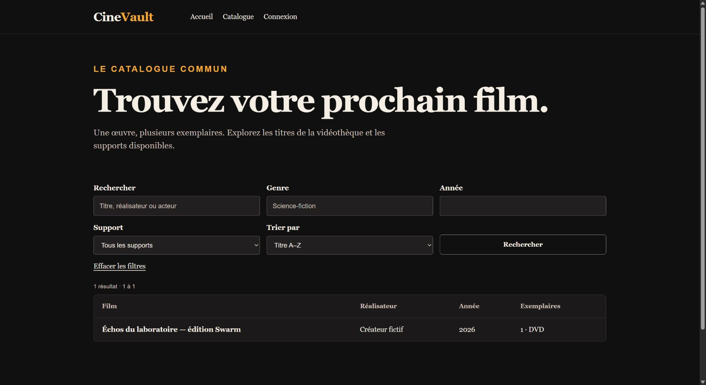

# Identité visuelle et contrôles d'usage

Référence : présentation Flask/Jinja au commit web `f3d10cb0d5c9233c6427bd6503f3d2b841e99548`. L'interface associe fond sombre, texte clair et accent ambre, avec typographie éditoriale et formulaires natifs. Aucun JavaScript applicatif ni animation décorative n'est requis pour les parcours.

## Jetons et composants réellement présents

| Jeton CSS | Valeur | Usage |
|---|---|---|
| `--bg` | `#111011` | Fond de page |
| `--surface` | `#1b1919` | Tableaux, cartes et états vides |
| `--text` | `#f5eee5` | Texte principal et navigation |
| `--muted` | `#c9beb5` | Texte secondaire et placeholders |
| `--accent` | `#f2a838` | Actions principales et repères |
| `--line` | `#48413d` | Séparateurs de structure |
| `--danger` | `#d67a69` | Information de danger |

Le corps utilise Georgia/Times,17px et interligne1,5 ; les contrôles utilisent Arial,16px, avec espacements12/14px. Le conteneur est borné à1240px ; les titres utilisent clamp et les textes susceptibles d'être longs disposent de règles de retour à la ligne. Les composants sont boutons principal/secondaire/danger, cartes, tableau, étiquettes, alertes, notices, champs, états vides, pagination et affiches avec crédits. Les styles partagés évitent qu'un même état change de sens entre pages.

Les formulaires possèdent des labels et messages de champ ; les actions de suppression, conflit et indisponibilité ont des traitements distincts. Une mutation incertaine ne donne pas un faux message de succès. La sémantique HTML et le contrôle API portent les droits ; masquer un bouton n'est pas une autorisation.

## Adaptation et clavier

Sous700px, navigation et filtres passent en colonnes, les lignes de catalogue deviennent des cartes avec labels de valeurs. Le focus visible est un contour de3px avec décalage3px ; le lien d'évitement apparaît au focus. Les préférences reduced-motion réduisent animations et transitions. Ces règles CSS sont vérifiées sur les écrans observés, sans conclure à la conformité de tout état possible.

Le parcours Tab réel sur le catalogue a atteint14éléments dans l'ordre : évitement, navigation, champs et choix, recherche, effacement, film et footer. Aucun focus programmatique n'a été utilisé pour cette preuve. À390px et820px, le document mesure375/805px : aucun débordement de page. Une recherche sans résultat, son état vide et le retour au catalogue ont été exercés réellement. Voir [la trace clavier](../evidence/browser-20261109/keyboard-traversal.json) et [la synthèse navigateur](../evidence/browser-20261109/verification.json).

## Contrastes mesurés et correction

Le texte courant relevé sur le catalogue dépasse les seuils usuels : environ16,49:1 pour le principal et10,41:1 pour le secondaire sur fond de page ;9,60:1 pour les en-têtes de tableau sur leur surface. Les placeholders natifs restaient à3,56:1. La correction réutilise le jeton secondaire et fixe l'opacité à1 : **8,99:1 observé dans Chrome après déploiement** sur fond de champ `rgb(33,31,31)`.

La console du parcours était vide d'erreurs/avertissements. Ce contrôle ciblé ne constitue ni une certification WCAG exhaustive, ni un essai de lecteur d'écran, de tous les écrans privés ou de tous les navigateurs. Les observations antérieures de comptes, prêts et mobile restent datées et distinctes de cette campagne publique.
