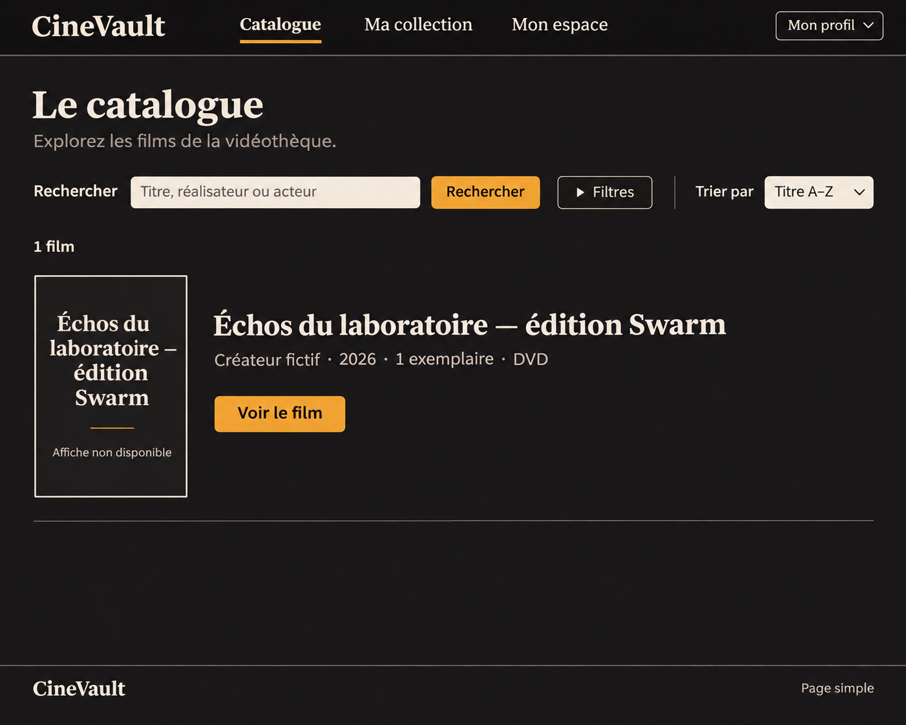

# Références de conception CineVault 2.0

## Catalogue membre — direction retenue

| Propriété | Valeur vérifiée |
|---|---|
| Fichier | `member-catalogue-concept-v2.png` |
| Nature | Maquette générée par ImageGen ; direction de conception retenue par le principal dans le mandat autonome |
| Dimensions natives | **1402 × 1122 px**, lues depuis le fichier le 10 novembre 2026 |
| Dimensions demandées dans l'intention du prompt | Écran catalogue desktop 1280 × 900 ; ne pas confondre intention et dimensions du PNG |
| SHA-256 | `e572d6658e1d5b03db82741bc41ac2e79ff5e6df4541dd3a819cc46cb11c8d96` |
| Origine décrite par le principal | Maquette UI complète du catalogue membre, sombre/ivoire/ambre, basée sur le film synthétique audité et son absence d'affiche |
| Texte intégral du prompt / identifiant de génération | Non archivé dans ce fichier ; ne pas les reconstituer comme preuve |
| Usage | Référence de hiérarchie, palette, rythme et fallback ; jamais capture après, résultat Playwright ou preuve d'accessibilité |

Le fichier a été ouvert avec `view_image` ; son empreinte et ses dimensions ont été vérifiées localement. Le concept montre un seul film réel du jeu synthétique audité : **Échos du laboratoire — édition Swarm**, **Créateur fictif**, **2026**, **1 exemplaire**, **DVD**. Cette quantité n'est pas un statut de disponibilité. Aucun poster autorisé n'a été ajouté.

## Copie et éléments autorisés pour cette vue

Marque CineVault ; navigation Catalogue, Ma collection, Mon espace et Mon profil ; titre « Le catalogue » ; phrase « Explorez les films de la vidéothèque. » ; Rechercher ; placeholder « Titre, réalisateur ou acteur » ; Filtres ; Trier par ; Titre A–Z ; nombre de films dérivé du résultat ; données de film réelles ; « Voir le film » ; « Affiche non disponible » ; Page simple.

Les valeurs `1 film`, année, quantité et titre sont des données de ce scénario, jamais du texte figé à recopier dans le code. Les destinations secondaires (Découvrir, Emprunts, Réservations, compte, Gestion selon droits) restent obligatoirement accessibles dans le shell décrit par [DESIGN.md](../../../DESIGN.md), même si cette image ne les expose pas toutes. Filtres actifs, pagination et erreurs sont les continuations fonctionnelles requises.

## Écarts intentionnels à traiter en implémentation

- Convertir les pixels ImageGen en layout fluide, aux dimensions de test réelles ; pas de reproduction d'un screenshot comme UI.
- Conserver les couleurs exactes spécifiées plutôt que le grain et les reflets générés. Rayon/ombres/bordures suivent le [design system](../DESIGN_SYSTEM.md).
- Titres en Georgia ; UI en Arial 16 px et contrôles de 44 px minimum. La maquette ne dispense pas de retours à la ligne lisibles ni d'une police explicite sur les contrôles.
- Indicateurs natifs de divulgation/tri ; pas de triangle texte approximatif imposé par la génération.
- Bordures de contrôles et focus utilisent les tokens de contraste ; les séparateurs décoratifs sombres ne servent pas à identifier un champ.
- Dans le fallback, le titre répété n'est pas répété inutilement aux technologies d'assistance ; titre principal intégral conservé.

## Références encore absentes et vérifications attendues

Le registre ne contient pas de concept spécifique de fiche, gestion, administration, mobile ou état d'erreur. Leurs exigences écrites sont dans [PRODUCT.md](../../../PRODUCT.md) et [DESIGN.md](../../../DESIGN.md). Si une zone exige une extraction visuelle plus précise, produire une référence complète cohérente avant de prétendre à sa fidélité. Ne pas présenter les vues absentes comme approuvées visuellement.

Les captures v1 authentiques et la revue d'origine sont conservées dans le dossier de travail `work/v2-audit/screens-v1/` et `work/v2-audit/ux-review.md` de la mission. Elles ne sont pas incluses dans ce sous-dossier. La capture catalogue avant a été ouverte durant la rédaction ; les autres observations sont celles de la revue, sans prétention à une seconde inspection exhaustive.

Pour la réception : comparer image de référence et vraie capture rendue avec `view_image`, puis consigner au minimum copie, géométrie, typographie, palette, fallback, espaces et responsive. Mesurer les cibles à 1280×900 et tester 320/390/768/1280, rôle/route/jeu de données/filtre égaux. Aucun test fonctionnel, axe-core, parcours clavier ou score performance n'est établi par cette maquette.
