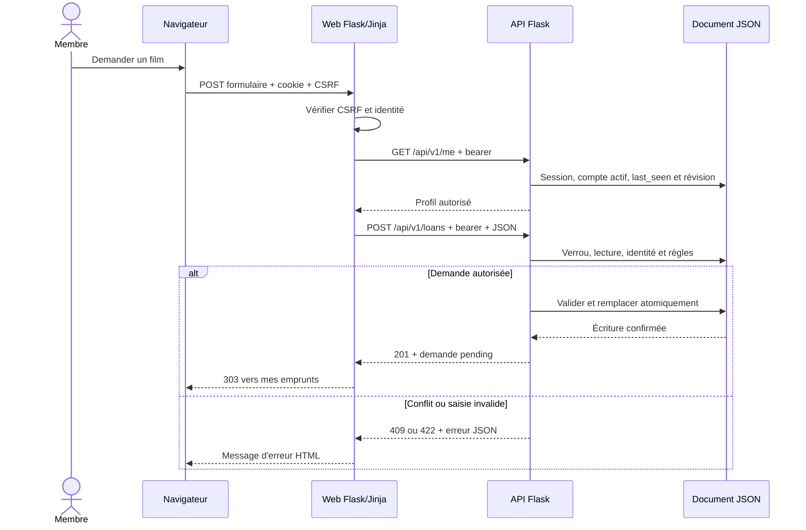

# Modèle d'exécution et messages

**Périmètre historique :** ce modèle correspond au jalon qualité du 7 novembre 2026, avant les révisions d'admission/authentification et la mise à jour distribuée. Voir la [synthèse courante datée](validation-current.md), qui n'attribue pas les nouveaux résultats aux anciens commits. Les liens de source ci-dessous ciblent des révisions immuables locales destinées à la publication ; leur disponibilité publique n'a pas encore été vérifiée.

Modèle du code Enterprise local, révisions API `e7ff089` et web `4303ef3`. Il complète le contrat OpenAPI et [l'inventaire des pages](frontend-inventory.md). Le navigateur échange HTML et formulaires avec la présentation ; celle-ci adresse l'API en HTTP/JSON pour les opérations métier. Le navigateur charge directement les images facultatives depuis les domaines Wikimedia HTTPS autorisés, sans transmettre le cookie CineVault et avec `referrerpolicy="no-referrer"`. Les Dockerfiles configurent Gunicorn avec deux processus par service ; cette configuration ne prouve pas l'état du déploiement distant. Les processus ne partagent pas de mémoire métier.

## Appel synchrone et frontières de confiance

Chaque appel web attend la réponse de l'API avant rendu ou redirection. Le client applique un délai de connexion de 2 s et de lecture de 5 s ; les opérations de métadonnées explicitement identifiées disposent d'un délai de lecture de 25 s. Une redirection API est refusée. Aucune mutation n'est rejouée automatiquement. Ces délais ne constituent pas un délai maximal global garanti d'un parcours composé de plusieurs appels.

Le cookie d'authentification HttpOnly est relayé comme bearer vers l'API, jamais comme paramètre d'URL ni vers Wikimedia. La session de présentation porte le CSRF ; le stockage API porte seulement les empreintes des jetons et les données d'autorisation. L'API relit compte, activation et rôle dans la transaction pour chaque opération privée. Une validation web améliore le formulaire mais ne dispense jamais de validation serveur.

## Réception, ordre et atomicité

`V2Store.transact` prend un verrou interprocessus sur un fichier compagnon, relit et décode le document, exécute le traitement métier, incrémente sa révision puis revalide tout le document. L'encodage UTF-8 est écrit dans un fichier temporaire du même dossier, synchronisé, remplacé atomiquement, puis le dossier est synchronisé sur les systèmes qui le permettent. Le verrou est libéré après cette séquence. Une exception avant remplacement préserve l'ancienne version. Les accès d'initialisation, lecture et instantané emploient également le verrou. Un fichier absent/corrompu n'est pas remplacé silencieusement par un catalogue vide.

Deux requêtes portant sur le même exemplaire sont sérialisées : la seconde relit l'état créé par la première. La validation du prêt vérifie disponibilité, état, bénéficiaire actif, quotas et priorité des réservations dans cette même transaction. Une API unique sur un volume local est conservée ; deux processus Gunicorn sont compatibles avec le verrou du même hôte. Ni le verrou local ni le volume local ne garantissent une cohérence multi-hôte ou une haute disponibilité.

Les remplacements/suppressions de films, exemplaires et collections, ainsi que les transitions versionnées de prêts et réservations, demandent `If-Match` : absence 428, version obsolète 412. Les modifications de profil, mot de passe et comptes ne l'exigent pas. Le client doit recharger et comparer plutôt qu'écraser. La clé d'idempotence est obligatoire pour l'import ; elle est facultative côté API pour la création d'exemplaire et fournie par son formulaire web. Liée à l'acteur et à l'empreinte du corps, elle rejoue le reçu pour même clé/même corps et retourne 409 pour un corps différent. Sa rétention de 24 heures ne couvre pas arbitrairement toutes les routes POST.

Une lecture privée n'est pas une lecture pure du fichier : `protected` actualise `session.last_seen`, puis `transact` incrémente la révision et réécrit le document. Certains refus renvoyés depuis le callback conservent cette écriture technique sans modifier la ressource métier refusée ; une exception avant commit suit un autre chemin. Les GET privés concernés peuvent également expirer des réservations. Les lectures publiques du catalogue utilisent `read()` sans cette actualisation de session. Ces écritures techniques participent à la contention du verrou.

## Familles de messages et traitements

| Famille | Message reçu par l'API | Traitement et état produit | Réponse / échecs caractéristiques |
|---|---|---|---|
| Authentification | register, login, logout ; JSON des identifiants ou bearer | Validation, hachage Argon2id, compteur anti-abus, empreinte du jeton, révocation | Profil ou bearer à la connexion ; 401/409/422/429 ; aucun mot de passe dans les réponses |
| Profil et administration | GET/PATCH me, PUT password ; GET/PATCH users | Identité imposée, rôle admin pour autrui, dernier admin actif protégé | Profil public/pagination ; changement secret/droits révoque sessions |
| Catalogue | GET/POST/PUT/DELETE movies et copies ; filtres/versions | Validation, recherche/tri/pagination, doublons, références et disponibilité | 200/201/204 ; 404/409/412/422/428 |
| Collections | GET/POST/PUT/DELETE collections | Propriétaire dérivé du jeton, types et références vérifiés, journal minimal | Liste/entrée propre ; ressource étrangère 404 même pour admin |
| Prêts | GET/POST loans et actions approve/return/cancel | Demande pending ; attribution active ; retour returned ; annulation cancelled | 201/200 ; conflits 409, version 412/428, rôle 403 |
| Réservations | GET/POST reservations et cancel | FIFO séquentiel, expiration évaluée au passage, attribution atomique avec le prêt | waiting/fulfilled/cancelled/expired ; aucun envoi asynchrone de notification |
| Transfert | Import JSON ou CSV normalisé ; export format choisi | Décodage, normalisation et validation sur copie candidate sous verrou de transaction, puis affectation et écriture atomique ; politique doublons, reçu et export liste blanche | Aucun lot partiel ; fichier métier supérieur à 1 Mio : 422 ; plafond de transport web 2 Mio/API 8 Mio : 413 à la couche concernée ; conflit 409 |
| Statistiques et recommandations | GET statistics/recommendations avec portée/filtres | Calcul déterministe à partir de l'état autorisé ; agrégats d'exploitation séparés des collections privées | Données/explication ; 403/422 pour portée/filtre interdit |
| Métadonnées et affiches | GET metadata/search/detail ; GET posters ; source lors du CRUD | Fournisseur optionnel, cache/quota séparés ; réseau hors verrou principal, autorisation revérifiée ; références d'affiches publiques depuis cache | Aucun appel d'enrichissement par l'API pour une fiche anonyme ; téléchargement de l'image directement par le navigateur vers Wikimedia |
| Santé API, port 8000 | GET /health | Lecture/validation du stockage requis par le mode | 200 avec `status: ok` ou 503 ; ne valide pas tous les parcours distribués |
| Santé web, port 5000 | GET /health | Réponse locale de présentation, sans appel API | 200 avec `status: ok` ; ne démontre ni accès à l'API ni lecture du JSON |
| Reprise hors HTTP | Primitive Python `V2Store.snapshot(destination)` puis CLI `app.recovery restore` | SHA et schéma, nouvelle cible sans écrasement ; reprise opérationnelle avec quarantaine des comptes et anciennes sessions invalidées | Pas de sous-commande CLI `snapshot` ; restauration exacte `V2Store.restore` distincte de la reprise opérationnelle ; aucun endpoint public de restauration |

Les champs, paramètres, schémas et codes par méthode sont définis dans [OpenAPI](https://github.com/HyMathew/cinevault-api/blob/4b15406c2a1125518fb9a52dc53e9f50545db28e/docs/openapi-v1.json), les contrats de domaine et les schémas JSON. Le test `test_contract_routes.py` compare les méthodes et chemins du contrat à la vraie `url_map` Enterprise ; cela détecte une dérive de route, pas la conformité sémantique de chaque réponse. Les tests métier et l'intégration HTTP fournissent des preuves distinctes pour leurs cas exécutés. Le mode pédagogique `/api/films` reste distinct et refuse ses mutations lorsque le mode Enterprise est activé.

## Pannes et limites de livraison

Une panne réseau n'indique pas nécessairement qu'une écriture a échoué : elle peut survenir après le remplacement du fichier, avant réception du reçu. L'interface 503 invite à vérifier le résultat avant de répéter une mutation ; les clés d'opération permettent de reprendre les seules créations qui en disposent. Les appels externes sont plafonnés et le cache peut fournir une donnée périmée selon les règles documentées ; une absence d'affiche n'empêche pas la lecture du catalogue.

Il n'y a ni file de messages, ni worker d'arrière-plan, ni réplication JSON, ni notification de réservation. L'expiration est une transition opportuniste lors d'opérations concernées. Swarm apporte l'orchestration des conteneurs, pas une transaction distribuée entre fichiers. Le JSON croît avec les entités et chaque transaction valide le document complet : la capacité doit être mesurée avant d'en déduire une échelle d'exploitation.

Les preuves du jalon qualité (preuves locales non publiées) rattachent les révisions aux suites locales et images ; les 167 contrôles Compose (preuves locales non publiées) couvrent notamment échanges web/API et persistance. Ils ne constituent pas une couverture exhaustive de chaque schéma et branche. À ce jalon historique, les tests Swarm, transport TLS et panne inter-VM restaient à réaliser ; les contrôles distribués ultérieurs sont décrits dans la synthèse courante, sans validation de TLS public ni de panne multi-hôte. Les séquences détaillées des autres opérations importantes et leur traçabilité académique restent à compléter après la revue indépendante (preuves locales non publiées).
