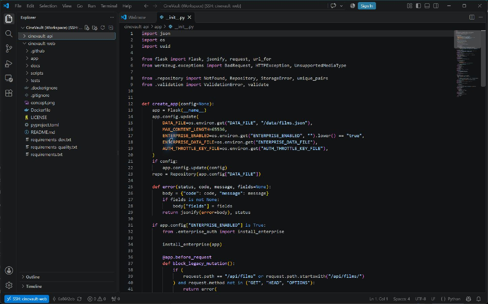
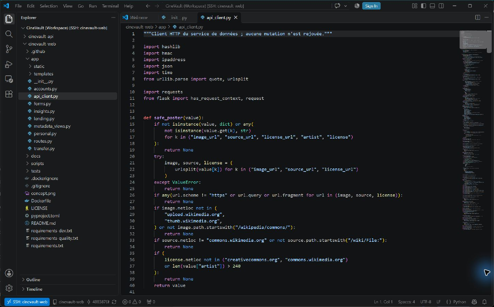
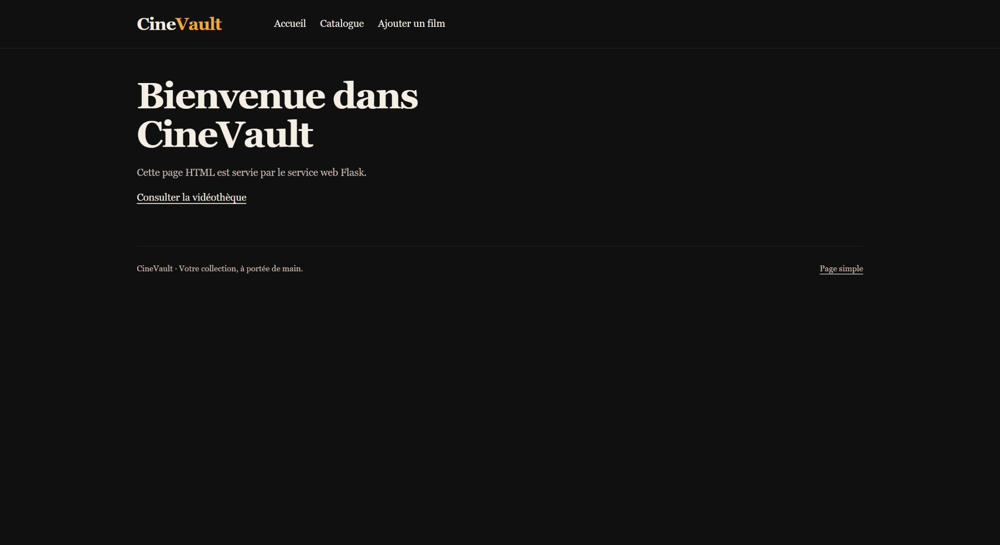
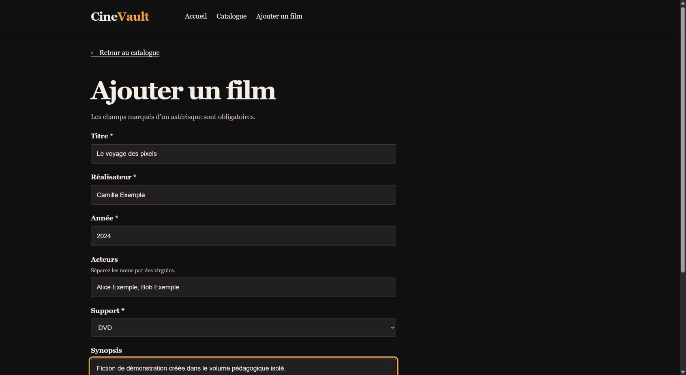
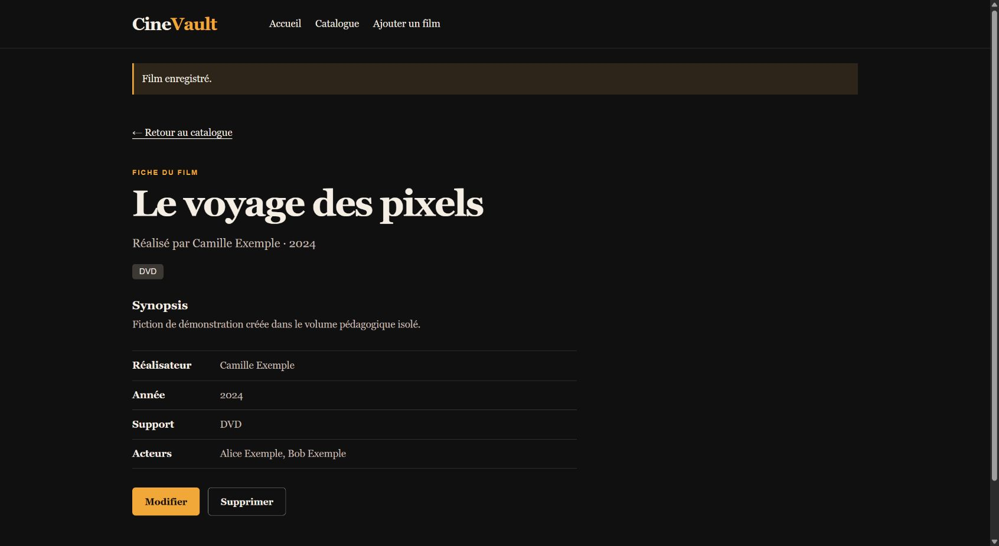

# Preuves du socle pédagogique — 9 novembre 2026

Cette campagne complète les exigences du sujet p.2 sans confondre le mode de développement avec la stack Enterprise distribuée. Les sources utilisées sont celles des images publiées : API `6a86f2eba9de4dd704c7d4a38d93ab75ff32adc5`, web `4883876f596e1e44218de762cad9a6ea6d1148c1`. Les captures sont authentiques ; les films et personnes saisis sont fictifs.

## Deux projets Git ouverts par VS Code Remote SSH

Les deux dépôts publics ont été clonés dans un nouvel espace de développement sur le worker web, puis placés aux révisions ci-dessus. Les clones sont propres après les essais. Un workspace distant contient les deux dossiers indépendants. Les captures montrent le fichier d'initialisation de l'API puis le client HTTP du frontend, les deux projets dans l'explorateur et l'indicateur SSH actif. L'administration est effectuée depuis le PC ; elle ne dépend pas des consoles du navigateur intégré.

Une connexion OpenSSH distincte avec `BatchMode=yes` et vérification stricte de la clé hôte a également réussi. Les lignes de diagnostic retenues attestent l'authentification `publickey` ; les journaux bruts et chemins des clés restent privés. Les captures VS Code seules ne prétendent pas démontrer la méthode cryptographique.

## Montage du code et volume de données distinct

Une pile Compose neuve a été lancée sur le worker web, sous un nom propre à cette campagne et sur un port loopback distinct. Elle utilise les images GHCR vérifiées avec deux bind mounts : dossier `app` de chaque clone vers `/srv/cinevault/app`, en lecture seule. Un volume nommé neuf, séparé, fournit `/data` à l'API. Le mode Enterprise est désactivé uniquement dans cette pile pédagogique : aucun compte ni fichier de la stack en service n'est réutilisé.

Les **16 contrôles de la campagne automatisée ont réussi** le 9 novembre à09h58UTC, soit10h58Paris. L'inspection effective a vérifié le type, la source, la destination et le drapeau lecture seule des deux montages. Les empreintes SHA256 du code hôte et conteneur sont égales. Un fichier témoin neuf et aléatoire créé dans chacun des dossiers hôtes a été lu identiquement depuis le conteneur, puis ce seul témoin a été retiré ; les deux clones restent propres. Aucun code applicatif n'a été modifié pour cette preuve.

Le volume de données est inscriptible, contrairement au code. Les deux services sont sains, en UID10001, avec racine en lecture seule et capacités retirées. La tâche web Swarm de l'application en service est identique avant et après l'essai. Cette séparation ne démontre ni un rechargement automatique du code Python, ni une synchronisation de volume entre machines ; aucun de ces comportements n'est revendiqué.

## Exercices A, B et C réellement exécutés

| Exercice du sujet | Manipulation et résultat observé | Preuve |
|---|---|---|
| A — HTML simple | GET `/page-simple` :200, titre « Bienvenue dans CineVault », sans appel métier nécessaire | Capture A ci-dessous et contrôle HTTP |
| B — formulaire et traitement | Saisie dans Chrome, soumission de « Le voyage des pixels », réalisateur Camille Exemple, année2024, acteurs Alice Exemple et Bob Exemple, support DVD ; redirection vers la fiche et message « Film enregistré. » | Captures formulaire et résultat ; le formulaire seul ne prouverait pas la soumission |
| C — Jinja à partir du JSON | Lecture du fichier JSON du conteneur API et requête HTTP réelle sur sa ressource : objet identique ; titre, réalisateur, année, acteurs, support et synopsis visibles dans Jinja | [Objet et comparaison observés](../evidence/academic-20261109/browser-json-chain.json), capture C |

Le script HTTP a d'abord créé un autre film fictif et comparé fichier, réponse API et rendu. Le parcours Chrome a ensuite créé le film des captures ; sa comparaison JSON a été vérifiée séparément. Les deux résultats ne sont pas fusionnés en une manipulation fictive. Les sessions et jetons CSRF ne figurent pas dans les pièces publiques.

Les [empreintes des six pièces publiées](../evidence/academic-20261109/manifest.json) permettent de contrôler leur intégrité. Les inspections de montages et reçus SSH détaillés sont conservés dans l'espace de preuves privé. Ces essais couvrent le socle pédagogique aux révisions citées ; ils ne remplacent pas les tests métier Enterprise ni la validation des modifications frontend ultérieures.
