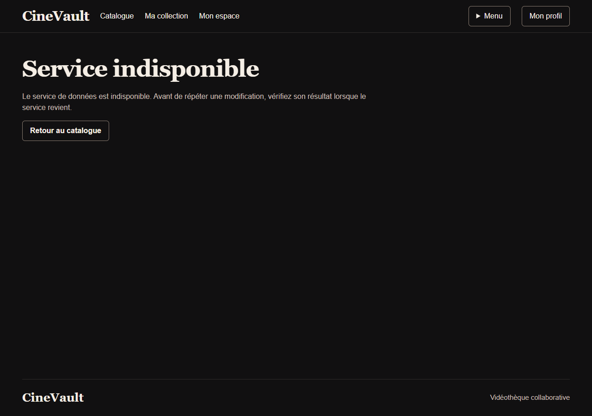
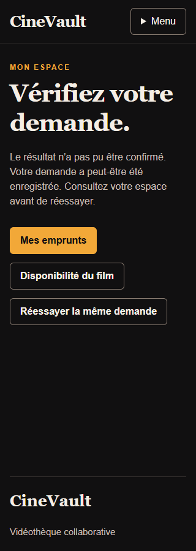
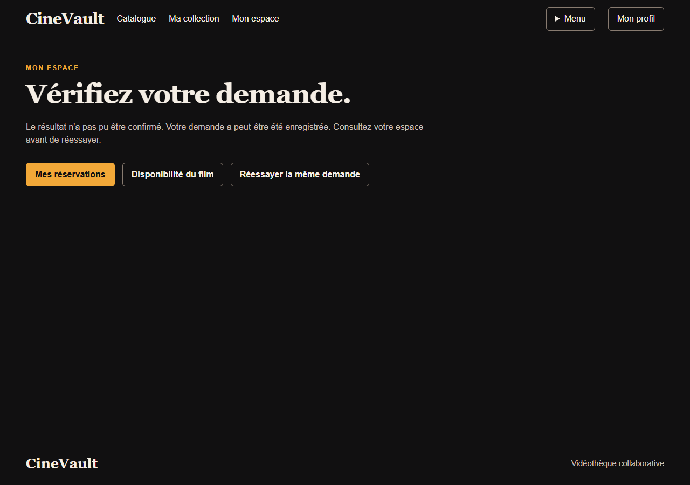
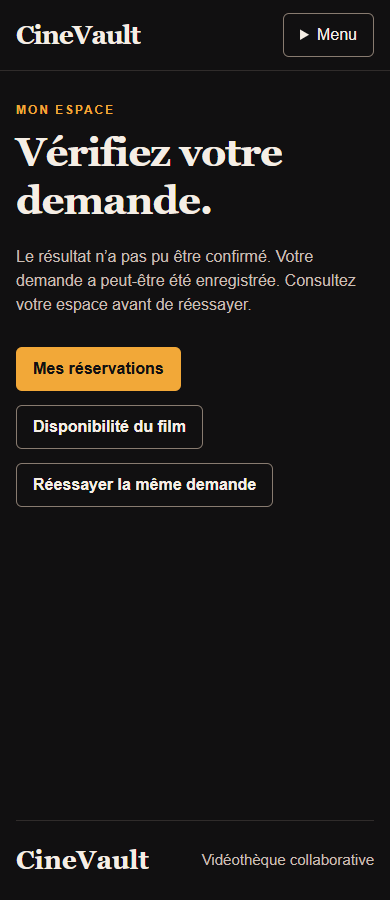

# Reprise web des demandes de prêt et réservation

Le [web7d602d3](https://github.com/HyMathew/cinevault-web/tree/7d602d33a0ce03e7ef178199e29a0f0a49114176)
ajoute une identité d'opération aux formulaires natifs de création. Après un503,
la page conserve même film, action et clé, propose de consulter son espace puis
de réessayer manuellement. Aucun envoi automatique n'est ajouté. Les transitions
existantes conservent leurs ETag. La
[CI43253243915](https://github.com/HyMathew/cinevault-web/actions/runs/43253243915)
a réussi sur ce commit exact, y compris l'audit d'image ; aucune image n'est
publiée ou déployée par ce run de branche.

## Preuves ciblées

Le [reçu public](../../evidence/public/lending-recovery-web-20261112.json) conserve
la campagne locale sur Flask/Jinja réellement rendu, avec **API explicitement
simulée**. Il ne prouve pas le rejeu d'un reçu ou la transaction du backend C4.

- Quinze tests initiaux ont échoué pour l'absence de clé/formulaire de reprise et
  d'argument client, puis réussi après modification ;27nouveaux tests couvrent
  les deux créations, refus, duplication de clé, CSRF et un seul appel par essai.
- La suite complète compte464tests réussis avec les avertissements en erreurs.
  La revue indépendante exécute50tests ciblés et26cas limites supplémentaires,
  notamment bornes, Unicode, trois503successifs et refus confirmés.
- Chrome157.0.8103.51 :130contrôles,16captures avant/après,320/390/768/1280px,
  aucun débordement de document. Huit scans axe ne relèvent ni violation ni cas
  incomplet dans ces états. Les erreurs de page et de console sont vides.
- De vrais Tab, Shift+Tab et Entrée atteignent puis activent le réessai. L'état
  observé confirme un seul nouvel appel manuel avec même clé et même payload,
  puis la redirection vers la liste. Les deux serveurs locaux possédés sont arrêtés.

Le plugin Browser étant absent, cette campagne utilise Playwright et Chrome
local. Le contrôle visuel a aussi séparé les trois actions avec le composant
actions partagé ; aucun nouveau CSS ou JavaScript produit n'a été nécessaire.
La référence graphique canonique est désormais
[DESIGN.md](https://github.com/HyMathew/cinevault-web/blob/f59c7af7d5bbe29493569b31403b924f20c3427a/DESIGN.md).
Ce commit ultérieur ajoute la documentation et son contrôle, sans modifier le
code applicatif de la campagne.

## Avant et après

## Limites à conserver

La conservation d'une clé web n'est pas une preuve d'idempotence API. L'intégration
réelle C4 doit encore vérifier réponse perdue après commit, acteur, concurrence,
conflit de payload et expiration24h. Une nouvelle fiche porte une nouvelle
intention ; aucune idempotence indéfinie n'est promise. Cette campagne à un moteur
ne certifie pas toute l'accessibilité, les performances, MongoDB ou TLS.
