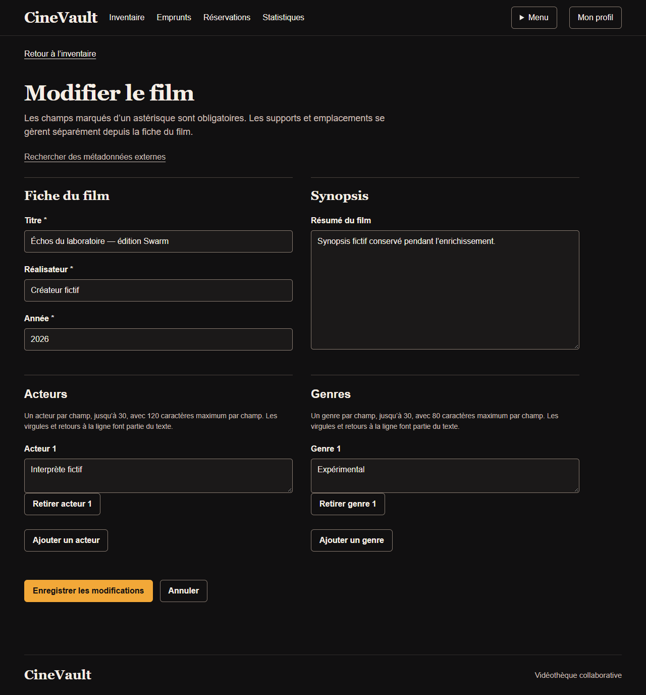
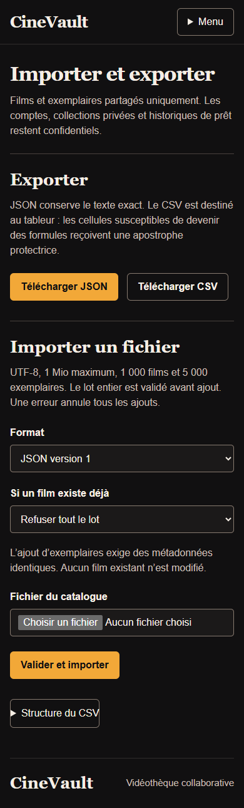

# Vérification des écrans de gestion

La campagne du 11 novembre 2026 porte sur le
[web8256166](https://github.com/HyMathew/cinevault-web/tree/8256166588ad770d3cb7cdaae93189de3fc0dcb3).
Les douze fichiers modifiés ont été comparés au commit après vérification des
empreintes utilisées pendant les essais. Le
[reçu public](../../evidence/public/management-ui-20261111.json) contient les
contrôles, dimensions, mesures et empreintes des preuves.

## Résultat et corrections

**437 tests web réussis**, avertissements traités comme erreurs, sans skip.
Chrome156 a exécuté **140 contrôles**, produit 58 captures et contrôlé 17 états
avec axe, sans violation détectée. Les quatre états où axe ne déterminait pas le
contraste des zones de texte ont été mesurés séparément : 22 observations,
rapport15,21:1 pour un minimum4,5:1. Bordure de champ4,26:1 et texte du bouton
principal9,43:1 sur leurs fonds calculés.

La campagne traverse les contrôles avec Tab, Shift+Tab et Entrée, en observant
l’élément actif. Elle vérifie les quatre largeurs320/390/768/1280, les textes
longs, états vides, refus412/503, conservation des clés lors des réessais manuels,
rotation après confirmation d’import et préremplissage sans écriture.

Deux régressions héritées ont été reproduites puis corrigées : Entrée dans le
titre pouvait retirer le premier acteur, et le lien d’enrichissement perdait le
film cible après une erreur d’édition. Les tests négatifs ont échoué avant les
correctifs, puis réussi avec les essais navigateur. Les listes de noms avec
virgules, CRLF, NUL et caractères supplémentaires conservent leur contenu exact
au retour serveur ; le glyphe de remplacement affiché par HTML pour NUL n’est pas
présenté comme une perte de la valeur stockée.

Un fichier temporaire multipart laissé ouvert par un test d’import a aussi été
identifié par trace d’allocation. Le test ferme désormais son flux et sa réponse,
sans filtrer l’avertissement ni modifier les règles de taille du produit.

## Captures authentiques

La [vue avant du même formulaire](../design/screens-v2-management/before-movie-edit-1280.png),
les [comptes sur desktop](../design/screens-v2-management/after-admin-1280.png),
les [noms longs à320px](../design/screens-v2-management/after-admin-long-320.png)
et l’[erreur de synopsis conservant les champs](../design/screens-v2-management/after-film-invalid-synopsis.png)
complètent la sélection.

## Limites

Le serveur Flask/Jinja est réel ; **l’API de cette campagne de présentation est
simulée** et utilise uniquement des données fictives. Les cinq erreurs réseau
412/422/503 observées dans la console sont celles volontairement provoquées ;
aucune erreur d’exécution JavaScript n’a été observée. Le serveur possédé a été
fermé après les essais.

Les [parcours avec les deux services réels](REAL_BROWSER_PAIR.md) sont des preuves
distinctes avec leurs propres révisions. Ni MongoDB REST, TLS, Swarm, la charge
ni une conformité globale d’accessibilité ne sont démontrés par ce lot.
