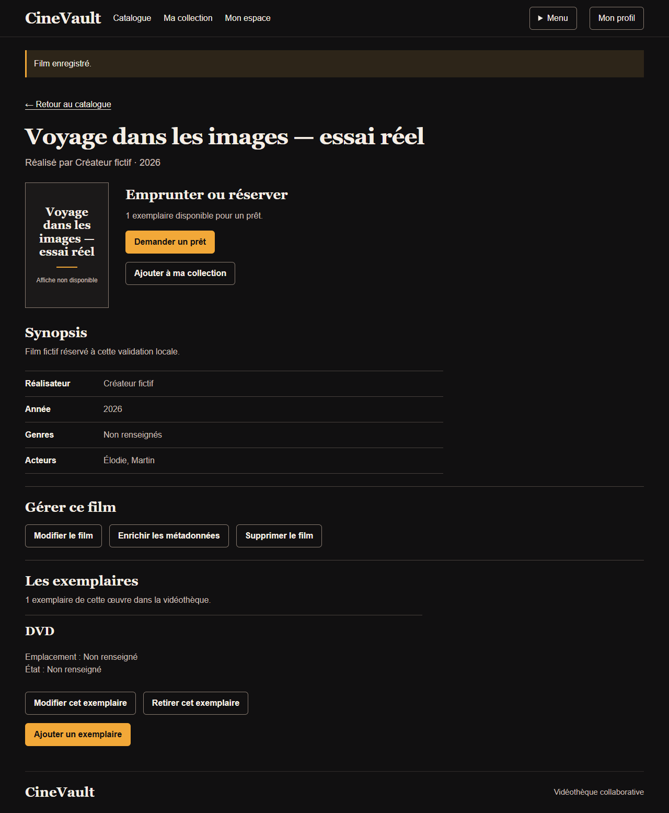
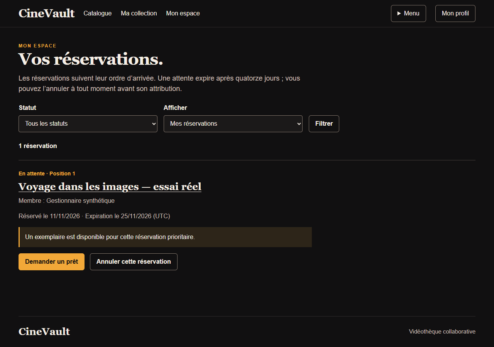
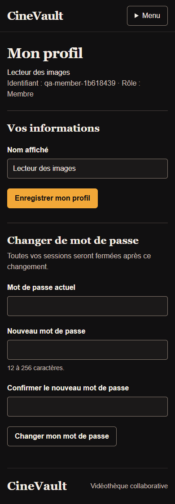

# Parcours Chrome avec les deux services réels

Le 11 novembre 2026, de 13:03:55 à 13:04:10 UTC, Chrome156.0.8078.80 a parcouru
le frontend Flask/Jinja, relié à une véritable API Flask en HTTP local et à son
fichier JSON temporaire. Les comptes et le film sont fictifs et ont été créés par
les routes de l’application. Les captures montrent ce rendu réellement exécuté.

Sources propres pendant la campagne :

- [API eb532ec](https://github.com/HyMathew/cinevault-api/tree/eb532ec84917662e92f83ca8f42b20f9bbd76fb9).
- [Web 57aa187](https://github.com/HyMathew/cinevault-web/tree/57aa187b9a7b4066023eff4913d1458f43a36694).
- [Reçu public, contrôles et empreintes](../../evidence/public/browser-pair-20261111.json).

## Comportements observés

Les **17 contrôles** du reçu ont réussi. Le parcours inclut inscription et
connexion, création de film et de son premier exemplaire, conservation d’un nom
d’acteur contenant une virgule, modification de profil, refus CSRF sans mutation,
refus de gestion pour un membre, favori privé et absence de cette entrée dans la
liste d’un autre compte. Il poursuit avec une demande de prêt, l’attribution par
le gestionnaire, une réservation pendant l’indisponibilité, le retour puis la
priorité de réservation rendue visible.

La lecture du fichier JSON confirme le profil, le propriétaire du favori,
l’emprunteur, un prêt retourné, une réservation en attente, un film et un exemplaire.
Le processus API s’est arrêté avec code0, le serveur web a été fermé et le dossier
de données temporaire a été supprimé. Aucun compte ou fichier du service stable
n’a été utilisé.

## Captures issues du parcours

Les [favoris privés sur mobile](../design/screens-v2-real/actual-collection-mobile.png)
et le [prêt retourné](../design/screens-v2-real/actual-returned-loan-mobile.png)
complètent les captures. Les images ne contiennent aucun mot de passe ou jeton.

## Portée de cette preuve

Cette campagne valide le chemin navigateur/web/API/JSON sur ces révisions. Les
essais natifs MongoDB des services communs sont une preuve distincte, conservée
par la [CI API](https://github.com/HyMathew/cinevault-api/actions/runs/43023482888).
Les endpoints HTTP Mongo complets, la migration, TLS, Swarm, la charge et les
courses avec plusieurs clients restent à valider dans leurs propres environnements.
Ce parcours à une réservation ne prouve pas à lui seul toutes les règles FIFO.

Le programme automatisé et son manifeste détaillé sont conservés dans le dossier
de travail de la mission ; leur intégration publique portable reste ouverte.
Les passes de présentation avec API simulée et leurs contrôles axe demeurent
identifiées séparément : cette campagne fonctionnelle ne remplace pas un audit
complet d’accessibilité. Les captures ne représentent pas un déploiement v2 livré.
